# Nortus Mobile

Aplicativo mobile (React Native + Expo) para **abrir e acompanhar ordens de serviço de oficinas** direto do celular. O mecânico ou atendente busca o cliente, identifica o veículo **fotografando a placa**, descreve o serviço (inclusive por voz), adiciona peças e fotos, e tudo é gravado no sistema de gestão da oficina através da [API Nortus](https://github.com/jvlm0/api-nortus-d).

<p align="center">
  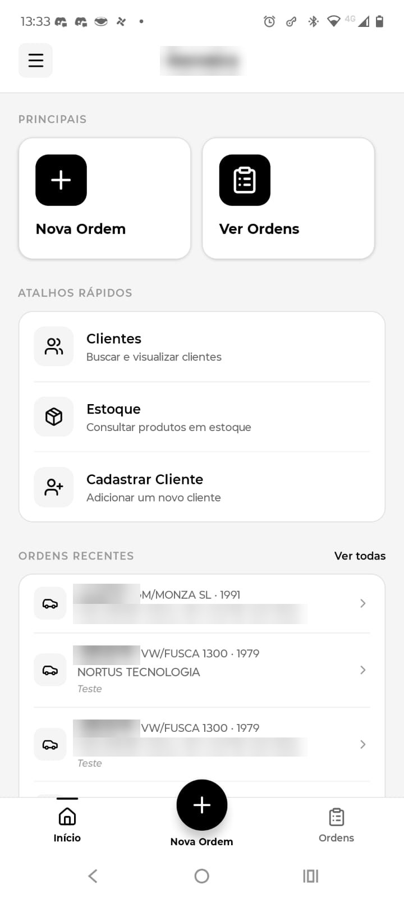
  &nbsp;
  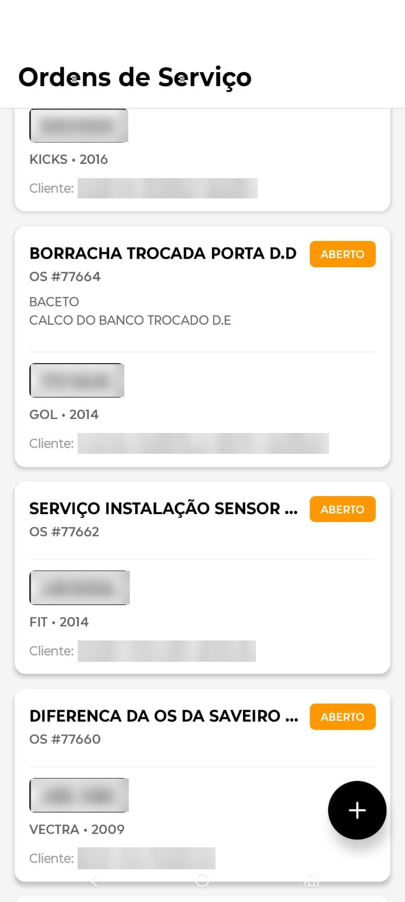
  &nbsp;
  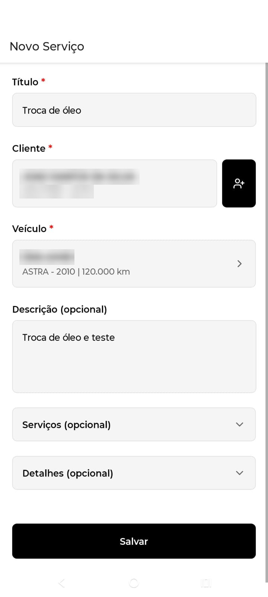
</p>

> Os dados de clientes e placas nas capturas de tela foram borrados.

## Funcionalidades

- **Login** com os usuários cadastrados na API. Os tokens JWT ficam guardados no aparelho e são renovados automaticamente quando expiram.
- **Ordens de serviço**: listagem paginada com status, ordens recentes na tela inicial, detalhes completos, criação, edição e exclusão.
- **Leitura de placa por foto**: a câmera captura a placa, um serviço de OCR extrai o texto e o app corrige confusões comuns (O/0, I/1, B/8...) nos formatos antigo (`ABC-1234`) e Mercosul (`ABC1D23`).
- **Preenchimento automático do veículo**: com a placa, a API devolve modelo e ano, buscando no banco da oficina ou numa consulta externa.
- **Clientes**: busca por nome ou telefone, com cadastro de pessoa física (CPF) ou jurídica (CNPJ).
- **Serviços, peças e problemas** na ordem, com quantidade, valor, desconto, equipe e vendedores.
- **Ditado por voz** (pt-BR) nos campos de descrição e observação.
- **Fotos na ordem**, tiradas pela câmera ou escolhidas da galeria.
- **Estoque**: consulta de produtos.
- **Temas** claro, escuro e azul.

## Telas

<table>
  <tr>
    <td align="center"><br/><sub>Início</sub></td>
    <td align="center">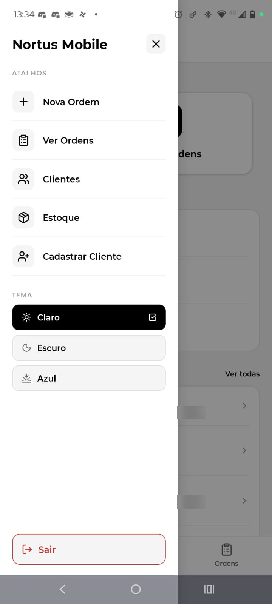<br/><sub>Menu lateral e temas</sub></td>
    <td align="center"><br/><sub>Ordens de serviço</sub></td>
  </tr>
  <tr>
    <td align="center">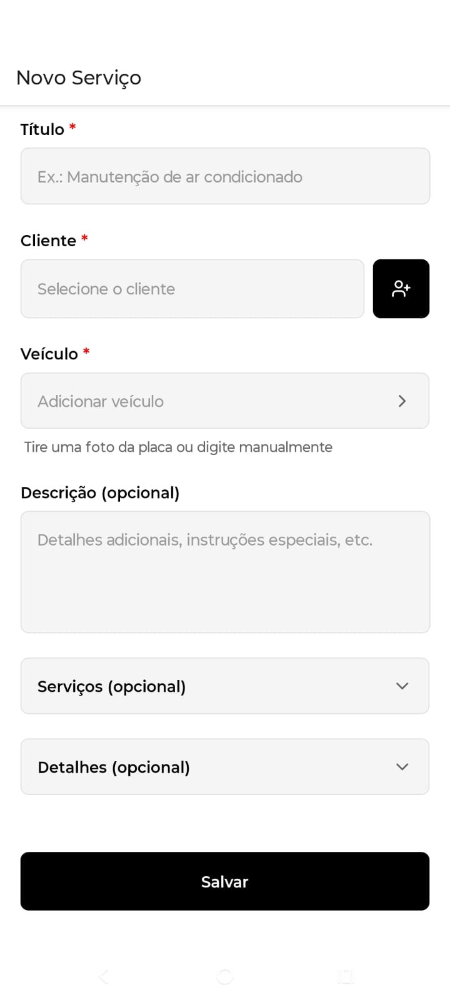<br/><sub>Nova ordem</sub></td>
    <td align="center"><br/><sub>Ordem preenchida</sub></td>
    <td align="center">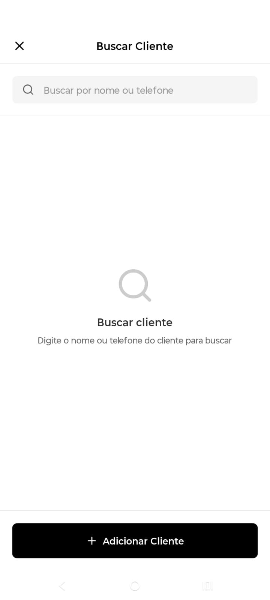<br/><sub>Buscar cliente</sub></td>
  </tr>
  <tr>
    <td align="center">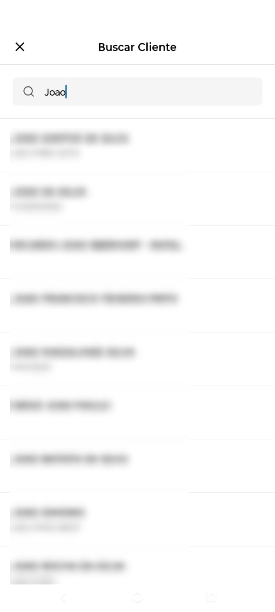<br/><sub>Resultados da busca</sub></td>
    <td align="center">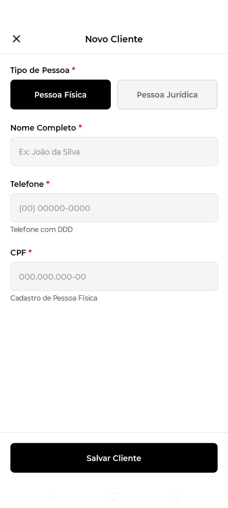<br/><sub>Novo cliente (PF)</sub></td>
    <td align="center">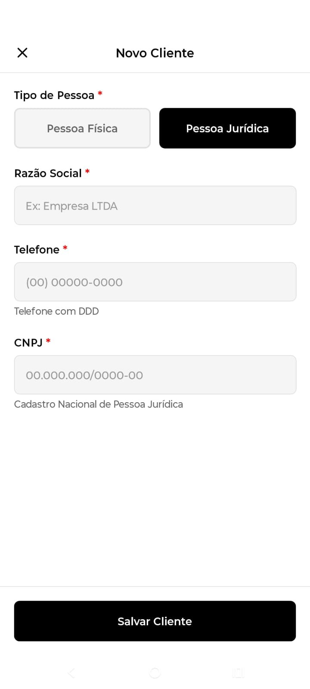<br/><sub>Novo cliente (PJ)</sub></td>
  </tr>
  <tr>
    <td align="center">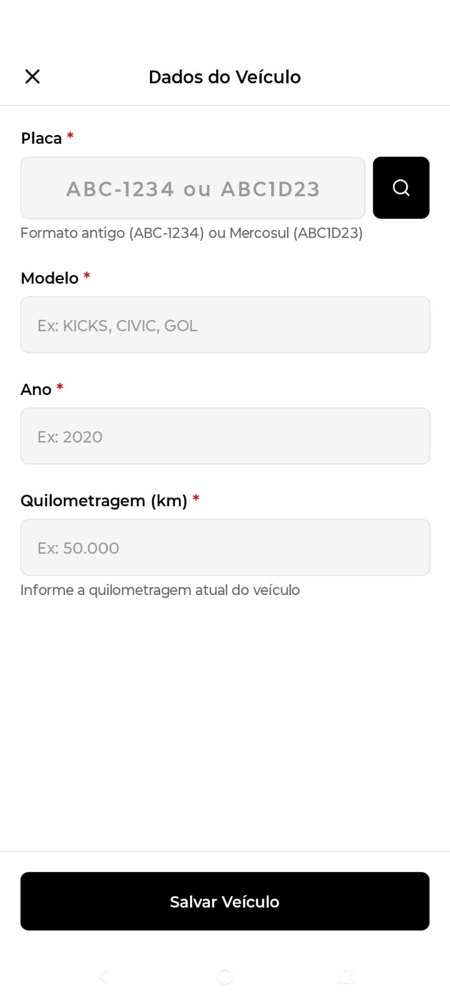<br/><sub>Dados do veículo</sub></td>
    <td align="center">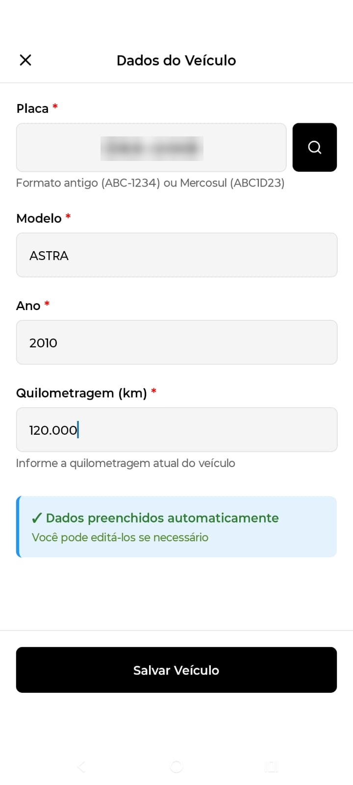<br/><sub>Veículo preenchido pela placa</sub></td>
    <td></td>
  </tr>
</table>

## Como funciona

```
┌──────────────────────┐   JWT    ┌─────────────────┐       ┌───────────────────────┐
│    Nortus Mobile     │─────────▶│    API Nortus   │──────▶│ Banco Firebird da     │
│ (React Native/Expo)  │◀─────────│    (FastAPI)    │       │ oficina (clientes, OS)│
└──────────┬───────────┘          └─────────────────┘       └───────────────────────┘
           │ foto da placa
           ▼
     API de OCR externa
```

- Toda a comunicação com a API passa por [src/utils/apiClient.ts](src/utils/apiClient.ts). Ele adiciona o token, aplica um timeout de 30 s e, ao receber `401`, renova o token com o refresh token e repete a requisição.
- A leitura de placa ([src/services/ocrService.ts](src/services/ocrService.ts)) redimensiona a foto, envia para a API de OCR e filtra o texto até achar uma placa válida.
- O ditado usa `expo-speech-recognition` em português, com resultados parciais enquanto a pessoa fala.

## Tecnologias

Expo 54 · React Native 0.81 · React 19 · TypeScript · Expo Router / React Navigation · expo-camera · expo-image-picker · expo-image-manipulator · expo-speech-recognition · AsyncStorage · lucide-react-native

## Estrutura

```
src/
├── app/index.tsx     # entrada: providers (tema, auth, formulário) e navegação
├── screens/          # telas (Home, OrderList, ServiceForm, VehicleForm, Camera...)
├── components/       # componentes por área (order-list, service-form, vehicle-form...)
├── hooks/            # lógica das telas (useServiceForm, usePlateCapture, useSpeechRecognition...)
├── services/         # chamadas à API e ao OCR
├── contexts/         # AuthContext, ThemeContext, FormDataContext
├── theme/colors.ts   # paletas clara, escura e azul
├── types/            # tipos TypeScript
├── utils/            # apiClient, formatadores, validadores
└── config/env.ts     # leitura das variáveis de ambiente
```

## Configuração

Crie um arquivo `.env` na raiz. Ele já está no `.gitignore`.

```env
EXPO_PUBLIC_API_URL=http://<endereço-da-api>:8000
EXPO_PUBLIC_API_OCR=<url-da-api-de-ocr>
EXPO_PUBLIC_OCR_KEY=<sua-chave-de-ocr>
```

> Variáveis `EXPO_PUBLIC_*` são embutidas no aplicativo compilado, ou seja, qualquer pessoa com o APK consegue extraí-las. Use uma chave de OCR restrita ou com limite de uso, ou faça o OCR passar pela API.

A API precisa estar rodando e acessível a partir do celular. Veja o README da [API Nortus](https://github.com/jvlm0/api-nortus-d).

## Como rodar

Pré-requisitos: Node.js 20+ e Android Studio (para Android) ou Xcode (para iOS).

```bash
npm install
npx expo run:android      # ou: npx expo run:ios
```

O app usa módulos nativos (câmera e reconhecimento de voz), por isso o recomendado é um **development build** (`expo run:*`) em vez do Expo Go. Depois do primeiro build, `npx expo start` basta para o dia a dia.
